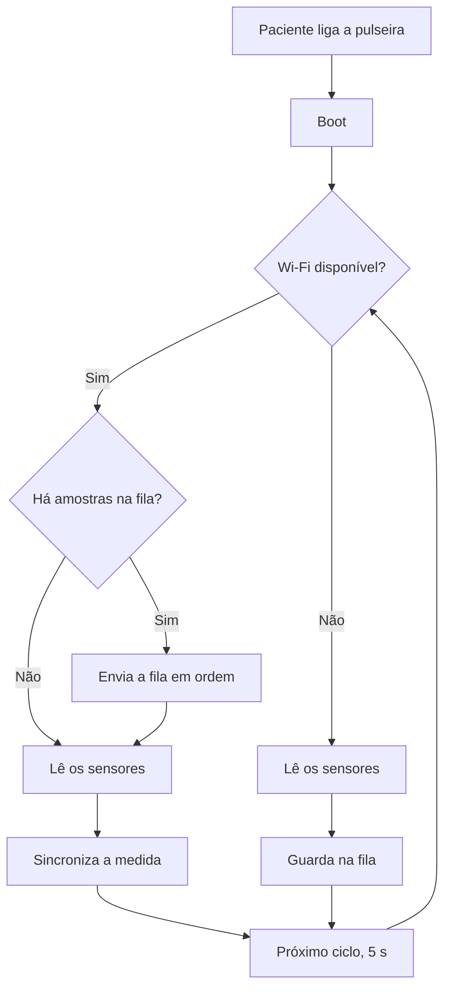

# Objetivo

A Parte 1 constrói uma pulseira simulada no Wokwi com um ESP32. O vestível lê a temperatura e umidade com um DHT22, obtém a frequência cardíaca por um botão convertido em batimentos por minuto e usa uma chave como indicador de Wi-Fi ligado ou desligado.

No boot, o sistema lê a chave e informa se a rede está conectada ou desconectada. Com o Wi-Fi ativo, as medidas saem a cada cinco segundos e sao transmitidas imediatamente. Se a rede está desligada ou cai no meio da operação, as amostras entram numa fila em RAM de 360 registros, por um tempo sem conexão. Quando o Wi-Fi volta, o lote é descarregado em ordem e o envio é confirmado.

O conjunto mostra computação na borda e resiliência offline numa aplicação de saúde. O monitor serial faz o papel do envio, porque o simulador não reproduz o armazenamento local como no hardware.

## Fluxo de funcionamento no dia a dia

O paciente coloca a pulseira e a liga. A partir desse momento ela já mede temperatura, umidade e batimentos, sem que ele precise fazer mais nada. A pulseira roda com bateria, e a economia de energia está descrita mais adiante. Ao longo do dia, as medidas formam o histórico que a equipe médica avalia a cada hora para tomar decisões e fechar diagnósticos. No boot, a pulseira procura o Wi-Fi. Se encontra a rede, lê os sensores e sincroniza a medida na hora. Se não encontra, a leitura continua e a amostra vai para a fila, que descarrega quando a rede volta.

## Arquitetura do Circuito

O ESP32 é o núcleo da pulseira. Ele executa todo o firmware, dispara as leituras e concentra a lógica de Wi-Fi: decide se a medida segue na hora ou entra na fila, conforme o estado da chave.

**Temperatura e umidade.** O DHT22 liga-se ao GPIO 4 e é alimentado em 3,3 V. Essas duas grandezas saem juntas a cada ciclo de leitura.

**Frequência cardíaca.** O botão substitui um sensor real e serve de aproximação do ritmo no simulador, onde não há eletrodo. Cada aperto entra no cálculo: sessenta mil dividido pelo tempo, em milissegundos, entre dois apertos aceitos. A média usa só os valores entre 30 e 220, no máximo os cinco últimos. Fora dessa faixa, o número sai como inválido e não entra na média. Sem aperto por três segundos, a conta volta a zero.

**Wi-Fi.** A chave representa a conexão: ligada significa conectado e desligada, desconectado. Uma espera de 100 ms confirma o novo nível antes de aceitar a troca, para que a flutuação do pino não dispare uma transição falsa.

## Consumo de energia

Entre uma leitura e outra, o ESP32 entra em light sleep. Acorda para o DHT22 e para o botão, no ciclo de cinco segundos. Num equipamento móvel, alimentado por bateria, isso reduz o consumo sem perder a qualidade das medições.

Numa aplicação real, o ideal é não varrer o Wi-Fi o tempo todo. O rádio deveria escanear a cada trinta segundos, em intervalos, porque a varredura também gasta energia. No Wokwi isso não se valida: a chave simula a conexão de forma digital. Esse comportamento fica como expectativa para o hardware real.

## Estratégia de Resiliência

### Escolha do armazenamento

O desenho prevê armazenamento local limitado. No ESP32 real, haveria uma opção de armazenamento local para guardar as amostras sem rede. O Wokwi, porém, não reproduz esse sistema como no hardware, e usá-lo aqui não demonstraria o mesmo comportamento.

A RAM guarda cada amostra na memória volátil enquanto a rede está fora. Enquanto houver espaço, as amostras não se perdem. Quando o limite de 360 registros é atingido antes da reconexão, as mais antigas são descartadas para dar lugar às novas, e o dado recente tem prioridade.

A escolha também segue o modelo de computação na borda: a decisão fica no próprio dispositivo, sem depender de armazenamento externo.

O tamanho da fila sai da cadência de leitura: cada amostra vale cinco segundos, então 360 amostras vezes cinco segundos dão 1800 segundos, isto é, trinta minutos de tolerância offline.

### Limite da fila

A fila comporta 360 amostras. Na cadência de cinco segundos, isso dá cerca de trinta minutos sem rede. Essa margem cobre sair de um elevador, passar por um túnel ou uma instabilidade momentânea, sem sacrifício. Como o armazenamento é RAM, esse custo é baixo. Se a fila enche antes da reconexão, as amostras mais antigas saem para dar lugar às novas, e o dado recente tem prioridade.

No ESP32, 360 registros ocupam poucos quilobytes de RAM, bem abaixo dos 520 quilobytes disponíveis. O teto da fila é uma escolha de projeto, não uma restrição do chip, e pode subir bastante sem encostar no limite do hardware.

### Sincronização na reconexão

Quando o Wi-Fi reconecta, o dispositivo recarrega a fila offline em ordem e envia cada amostra como foi medida, sem repetir, com uma mensagem de confirmação no monitor serial.

Com a fila vazia, a operação online retoma lendo e transmitindo os dados a cada 5 segundos. Esvaziar a fila equivale a apagar o arquivo local depois do envio.

## Cenários de teste

Foram considerados os seguintes estados nos testes: Wi-Fi ligado, Wi-Fi desconectado e Wi-Fi reconectado.

No Wi-Fi ligado, considerou-se se a leitura do sensor estava sincronizando corretamente, se foi identificado no boot se os dados estavam sincronizados.

No Wi-Fi desconectado, foi testado se o sistema continuou lendo os sensores, se manteve a integridade dos dados quando estava offline e se os guardou corretamente na fila.

No Wi-Fi reconectado, foi avaliado se todas as informações armazenadas no buffer foram realmente enviadas com sucesso e, depois disso, se o sistema voltou ao estágio normal do online, enviando diretamente sem passar pelo buffer.

Durante os testes, uma espera de 100 milissegundos foi aplicada para que cada mudança de estado da chave só valesse uma vez.

## Conclusão

O protótipo pedia um vestível no Wokwi com ESP32, no mínimo dois sensores, armazenamento local limitado, resiliência offline e transmissão para a nuvem. A Parte 1 entrega a pulseira CardioIA simulada: DHT22 para temperatura e umidade, botão para a frequência cardíaca, chave para o Wi-Fi, fila de 360 amostras em RAM com cerca de trinta minutos de tolerância, sincronização na reconexão e light sleep para economizar energia.

Ficam para o hardware real o sensor de pulso com eletrodo, a alimentação por bateria, a varredura de Wi-Fi a cada trinta segundos e a criptografia com autenticação. A CardioIA demonstrou computação na borda e resiliência offline numa aplicação de saúde em que perder medidas não é aceitável.

