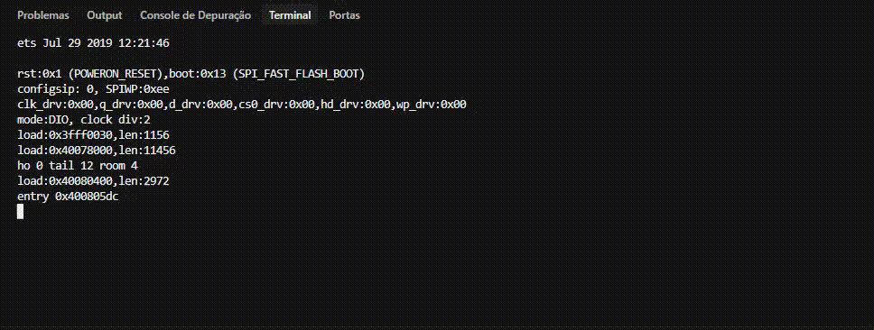
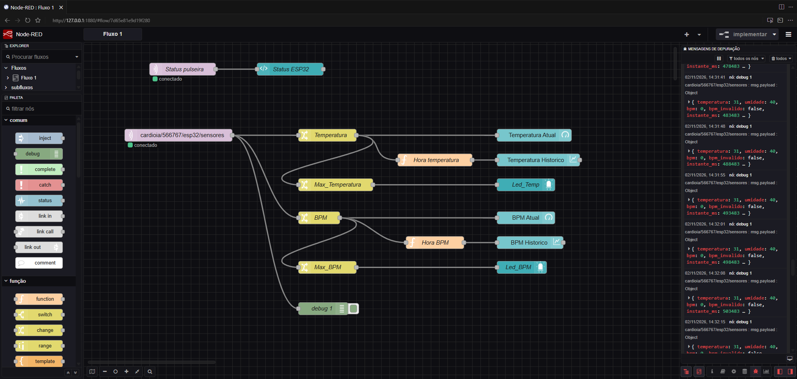
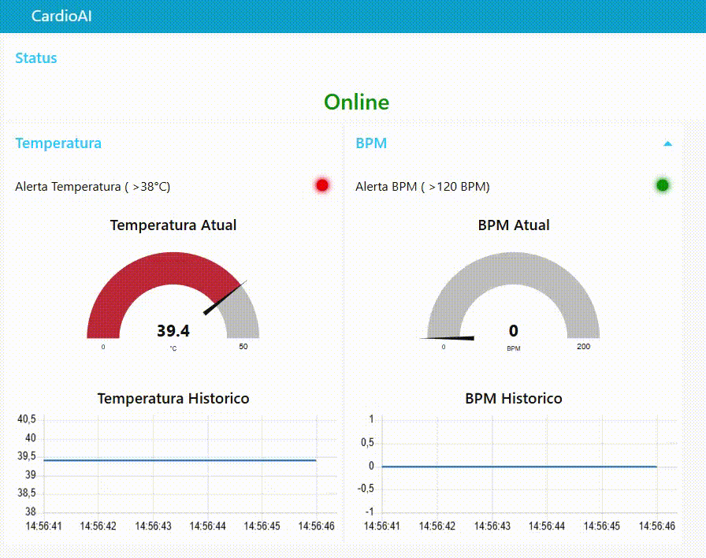
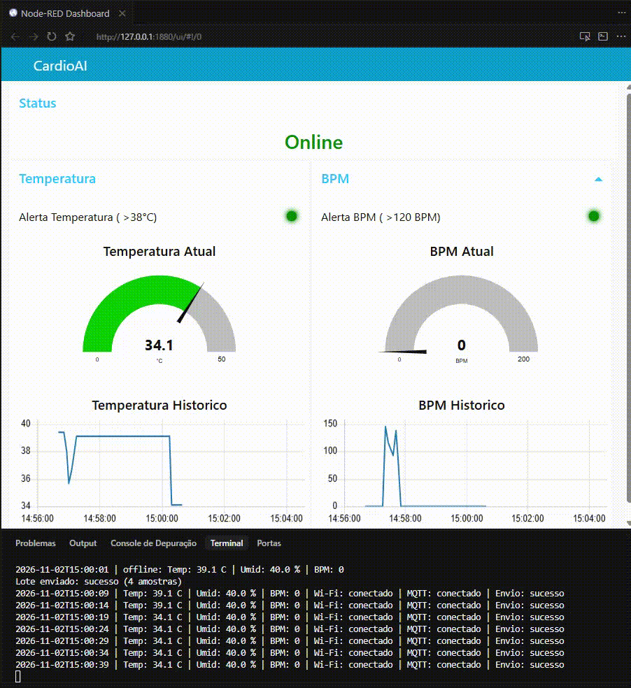

# Leitura conjunta de temperatura e frequência cardíaca

Temperatura e frequência cardíaca, lidas em conjunto, oferecem um retrato rápido do estado geral de quem usa a pulseira. Febre acompanhada de taquicardia pode indicar o início de uma infecção, desidratação ou uma resposta ao estresse. Frequência cardíaca baixa com temperatura normal acende outro sinal de atenção.

O valor da medida não está na leitura isolada, e sim na tendência ao longo do dia. Quando os dois indicadores sobem juntos, o alerta precoce chega antes que o paciente perceba qualquer sintoma. No protótipo, esse percurso deixa de ser apenas um alarme do instante: vira histórico no broker, disponível para o médico revisar.

## Arquitetura

O protótipo simula um ESP32 no Wokwi. O firmware lê temperatura e umidade em um DHT22 e estima a frequência cardíaca a partir dos intervalos do botão. A cada cinco segundos publica um JSON no tópico `cardioia/566767/esp32/sensores`, no broker público da HiveMQ (`broker.hivemq.com`, porta 8883, TLS). O estado da pulseira segue em outro tópico, `cardioia/pulseira/status`, com a mensagem retida. O projeto público no Wokwi está em https://wokwi.com/projects/479583124125573121.

O Node-RED, em execução local, assina os dois tópicos e monta o painel. O médico vê o valor atual, o histórico e o alerta sem precisar do monitor serial. A rede do simulador é a Wi-Fi aberta do Wokwi. Uma chave digital corta Wi-Fi e MQTT de propósito, para exercitar o comportamento sem conexão.

## Firmware

A função `lerAmostra` concentra a leitura do ciclo. A temperatura passa por um limite de 0 °C a 50 °C logo depois de `readTemperature`. Valor abaixo de zero vira 0; valor acima de 50 vira 50. Se o sensor devolver NaN, o número permanece NaN e o JSON sai com `null`, para o documento continuar válido. A umidade não entra nesse limite.

Sem rede, a amostra vai para uma fila circular de 360 posições. No ritmo de uma leitura a cada cinco segundos, a fila cobre cerca de trinta minutos. Quando enche, a amostra mais antiga sai. Na reconexão, o lote segue da mais antiga para a mais nova, e só deixa a fila o que o broker aceitou.

Cada mensagem leva o campo `data_hora` em ISO 8601, no fuso de Brasília, por exemplo `2026-11-02T14:23:00-03:00`. O relógio vem do NTP na primeira associação Wi-Fi. Depois disso, a hora de cada amostra é o instante de boot (`millis`) somado a essa base, também com a rede caída. O intervalo usa `unsigned long`, para não virar negativo por volta de vinte e cinco dias de aparelho ligado. Uma amostra lida antes do primeiro NTP não tem como ser datada, porque o instante dela é anterior à base do relógio. O campo e o serial escrevem `sem-relogio`, também quando essa amostra sai da fila depois da sincronização. A mesma função, `formatarDataHora`, alimenta o JSON e a linha serial, para os dois não divergirem. No monitor, a hora aparece sem o sufixo do fuso.

*Saída serial do Wokwi*

O estado da conexão fica no tópico de status, com retain. No `connect`, o cliente registra o testamento: se a sessão cair sem aviso, o broker publica `offline`. Assim que a conexão confirma, o firmware publica `online`. Quando a chave desliga a rede, `cortarRede` publica `offline` antes de chamar o disconnect do MQTT e só então corta o Wi-Fi. O disconnect é limpo; o `offline` explícito substitui o que estava retido, sem depender do testamento.

## Node-RED

O fluxo começa em um nó MQTT de entrada no tópico dos sensores. Um nó de mudança copia `data_hora` para a mensagem e, em seguida, separa `instante_ms` e o número que o medidor precisa, temperatura ou BPM. As funções `Hora temperatura` e `Hora BPM` ficam entre esse nó e o gráfico. Elas leem a string ISO 8601, convertem para milissegundos de epoch e gravam em `msg.timestamp`. O eixo do gráfico usa esse instante da medição, não a hora em que o lote chegou. Se o texto for `sem-relogio`, a função volta ao cálculo pelo `instante_ms`.

*Editor de fluxos do Node-RED, agora com o nó de status*

O painel tem dois grupos lado a lado, Temperatura e BPM, e um grupo Status por cima dos dois. Os medidores usam faixas de cor. No BPM, verde de 0 a 100, amarelo de 100 a 120 e vermelho acima de 120. Na temperatura, verde de 0 a 37 °C, amarelo de 37 a 38 °C e vermelho acima de 38 °C. Cada grupo tem um gráfico de linha. Um LED acende em vermelho quando a temperatura passa de 38 °C; outro, quando o BPM passa de 120. O grupo Status mostra Online em verde e Offline em vermelho. Espaçadores de uma coluna centram os medidores dentro do grupo.

*Comportamento do dashboard cruzando os limites de temperatura e BPM*

## Testes

Com a rede cortada, o serial seguiu registrando as leituras sem publicá-las: dezoito amostras de 46,9 °C entre 14:23:00 e 14:24:25, uma a cada cinco segundos. Na volta da rede, o lote saiu com `offline: true` e cada ponto entrou no gráfico no horário em que foi medido, espalhado nesse intervalo, e não empilhado no instante da reconexão. A partir de 14:24:30, as leituras de 31 °C aparecem como pontos separados, depois da série de 46,9 °C.

O indicador de status acompanhou a chave. Com o MQTT estabelecido, o painel mostrou Online em verde. Ao desligar a chave, o `offline` retido chegou ao Node-RED e o texto passou a Offline, em vermelho. Ao religar, o `online` retido devolveu o verde.

Num segundo corte, o ESP32 guardou quatro amostras de 39,1 °C e só as enviou quando a rede voltou, num único lote. A leitura ao vivo que veio em seguida caiu para 34,1 °C. O BPM, que por volta de 14:58 tinha chegado perto de 140, voltou a 0.

*Painel e serial após a volta da rede*

## Limitações e melhorias

O cálculo da hora deixou de usar um inteiro de 32 bits com sinal sobre o `millis`. Com `unsigned long`, o delta não fica negativo por volta de vinte e cinco dias de uptime. A volta natural do `millis`, perto de quarenta e nove dias, continua coberta pela subtração sem sinal, desde que a base do NTP e a amostra pertençam à mesma contagem.

No simulador, desligar o Wi-Fi pela chave nem sempre faz o broker disparar o testamento: o cliente encerra a sessão de forma limpa, e o rádio virtual não reproduz toda queda de um aparelho real. Por isso o firmware publica `offline` antes de desconectar. Em hardware físico, uma queda brusca de energia ou de enlace tende a deixar a sessão morrer sem o pacote de disconnect, e o testamento cumpre esse papel.

Grafana Cloud foi considerado para o histórico de longo prazo. Não entrou nesta entrega: o painel do Node-RED já cobre medidor, gráfico, alerta e o estado da pulseira pedidos no enunciado.
